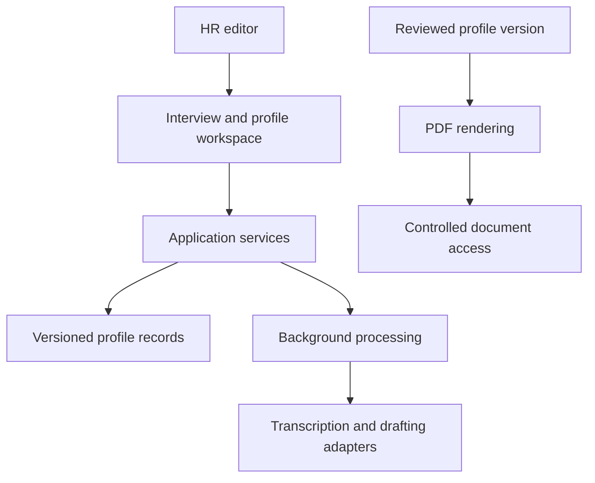

# HR Job Profiles — Interview-to-Document Workflow — Architecture

HR teams can consolidate several interviews into one job profile while keeping source material, editable drafts, finalized versions and PDF output in the same workflow. Drafting assistance supports the reviewer; it does not replace the HR approval step.

## Components

| Component | Responsibility |
|---|---|
| Web interface | React editing, interview intake, progress, history and preview screens. |
| Application API | FastAPI permissions, business operations, document versions and controlled downloads. |
| Durable worker | Transcription, synthesis and drafting outside interactive requests. |
| Persistence | PostgreSQL metadata and private storage for recordings and generated files. |
| Document rendering | PDF generation separated from the AI drafting stage. |

## Main interactions

## Responsibility boundaries

- Human review remains a distinct stage. The final job profile can be checked and corrected by HR.
- Generation does not overwrite a newer human revision. Concurrent drafting cannot silently replace editorial work.
- PDF rendering is separate from AI generation. The exported document corresponds to a defined content version.

## Constraints

Interviews and job profiles contain sensitive HR material. Access control, private file delivery and human review are central to the design.

## Technology

React, TypeScript, Vite, Python, FastAPI, PostgreSQL, server-side AI adapters, ReportLab and Docker.
